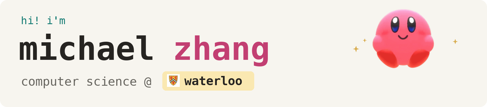

I’m a [Waterloo CS](https://uwaterloo.ca/computer-science/) student interested in continual learning, mechanistic interpretability, efficient ML, and AI safety. I want to know what a model remembers after it learns something new, and whether we can find that memory inside it.

### papers

**[A Bag of Concepts?](https://arxiv.org/abs/2611.19176)** · [code](https://github.com/Festyve/jspace-binding-experiments)  
“The doctor treated the lawyer” and “the lawyer treated the doctor” use the same words. Can we tell who did what to whom by looking inside the model?  
Co-first author · NeurIPS 2026 Interpretability as a Science Workshop

**[When Less is More](https://arxiv.org/abs/2512.18934)** · [code](https://github.com/Festyve/LessIsMore)  
We trained models on language, math, and code in sequence. In our experiments, 8-bit models struck the best balance between picking up new skills and keeping old ones.  
First author · NeurIPS 2025 CCFM Workshop

### things i've built

- **[Rally](https://github.com/nicholaskim17/rally)** turns two laptops into a ping-pong table. Each webcam tracks a player’s hand as their paddle. We took first place at the General Catalyst hackathon.
- **[J-space visualizer](https://festyve.github.io/jspace-viz/)** lets you pick a token and step through a model’s layers to see when a concept becomes readable.
- **Roblox games** · I founded a studio and built games in Luau. Together they’ve reached **1M+ visits**.

Previously, I interned at [RBC](https://www.rbc.com/), where I built a Java and Oracle service that processed **500,000+ stale records a week** for the investments team.

[website](https://michaelshihongzhang.com/) · [more projects](https://michaelshihongzhang.com/#projects) · [linkedin](https://www.linkedin.com/in/michaelshihongzhang/) · [x](https://x.com/michaelshzhang) · [email](mailto:mzhang3518@gmail.com)
